# Sari-sari Store — Inventory & POS

An offline-first Android inventory and point-of-sale app for a small Filipino sari-sari store, built with React Native (Expo), local SQLite, and optional Supabase cloud backup.

## Project Overview

Sari-sari Store is a mobile app I built on my own for my mother's sari-sari store, to replace manual tracking of stock, sales, and customer credit (*utang*) with one tool on her phone. It covers the core daily workflow of a neighborhood store: ringing up sales, keeping track of stock, recording which customers owe money, and checking how the business is doing.

Store connectivity can be unreliable, so the app is built **offline-first**. Every screen reads from and writes to an on-device SQLite database, so checkout never waits for the network. Changes are queued locally and synced to an owner-scoped Supabase PostgreSQL backend when a connection is available.

## Key Features

- **Point of sale:** cart and checkout with Cash, GCash, Maya (confirmed manually) and Utang payments, customer discounts, held (pending) sales, and owner-only void and refund.
- **Inventory management:** products with categories, images, cost/selling prices and low-stock thresholds. Stock levels are calculated from an append-only stock-movement ledger (stock in/out).
- **Barcode scanning:** camera-based scanning (`expo-camera`) with an offline lookup, used to add items to the cart, open product details, or fill in barcodes on product forms.
- **Utang (credit) tracking:** customer records with credit limits, credit transactions with due dates, and partial payment collection.
- **Dashboard and reports:** today's sales and profit, low-stock alerts, and summaries of gross/net sales, voids, refunds, inventory value and outstanding utang.
- **Receipts:** PDF receipts that can be shared or printed, plus direct Bluetooth thermal printing through a custom Kotlin Expo module that sends ESC/POS commands.
- **Offline sync and backup:** a local sync queue with idempotent retries, last-write-wins merging for editable records, and JSON backup/restore.
- **Security:** a 4-digit Owner PIN lock (stored only as a hash on the device), Supabase Auth for the cloud account, and row-level security that limits cloud data to its owner (`owner_id = auth.uid()`).

## Application Screenshots

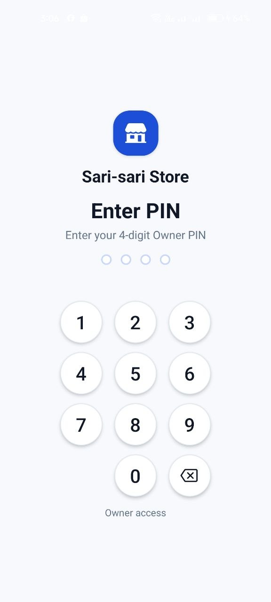
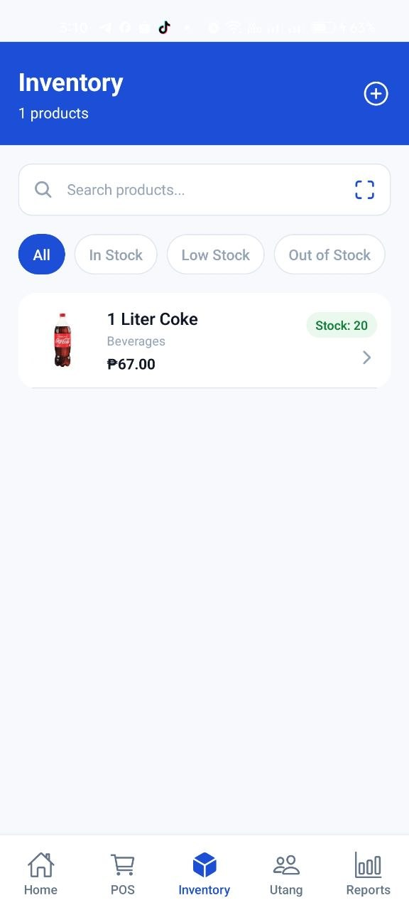
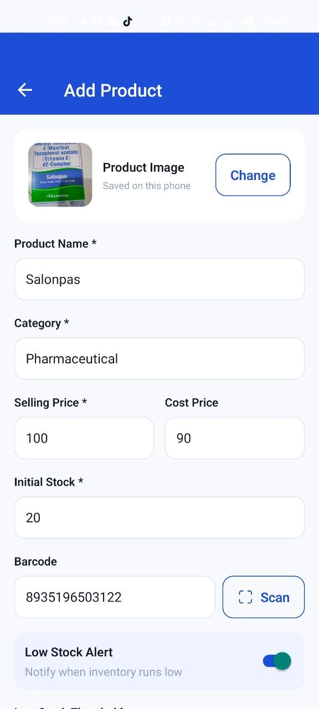
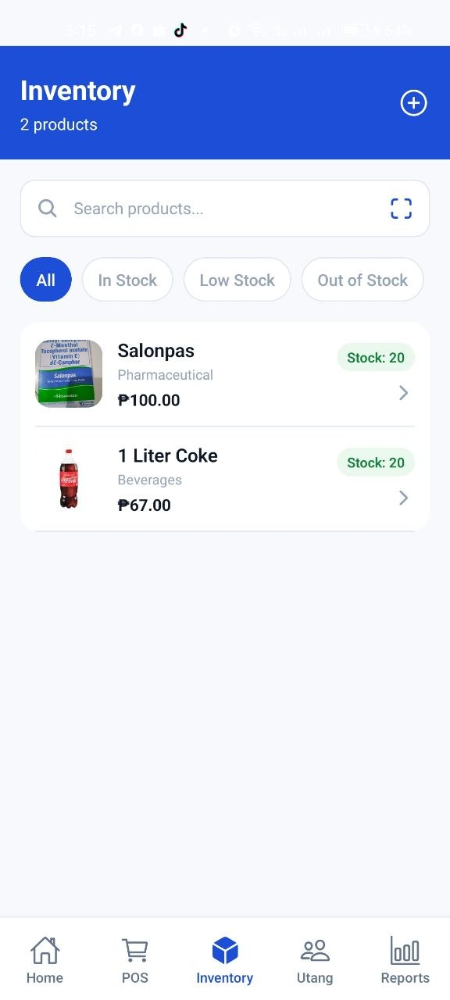
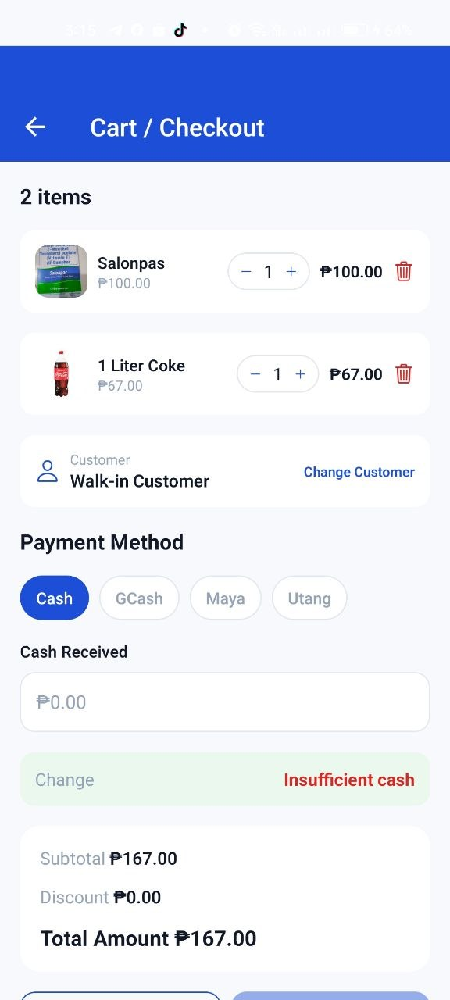
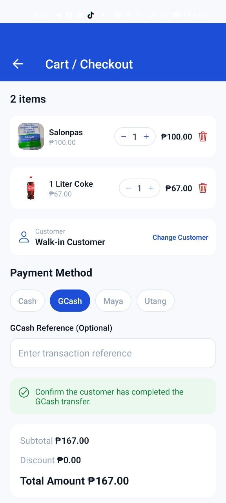
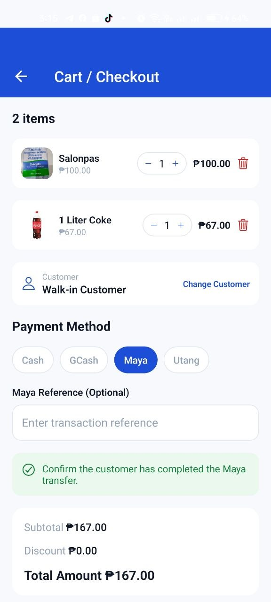
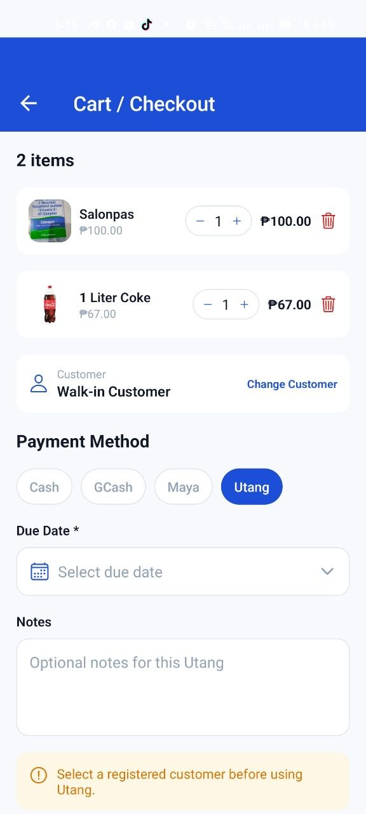
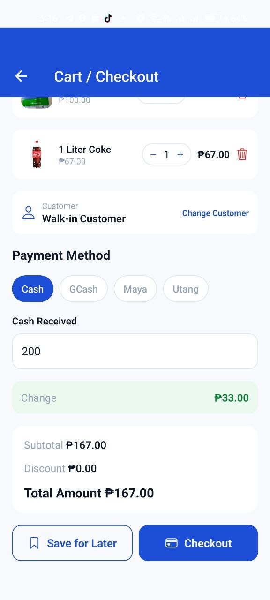
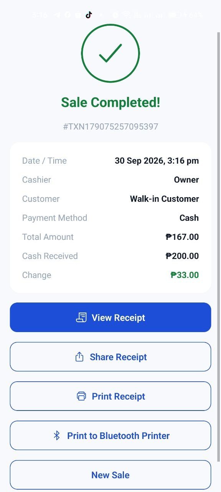
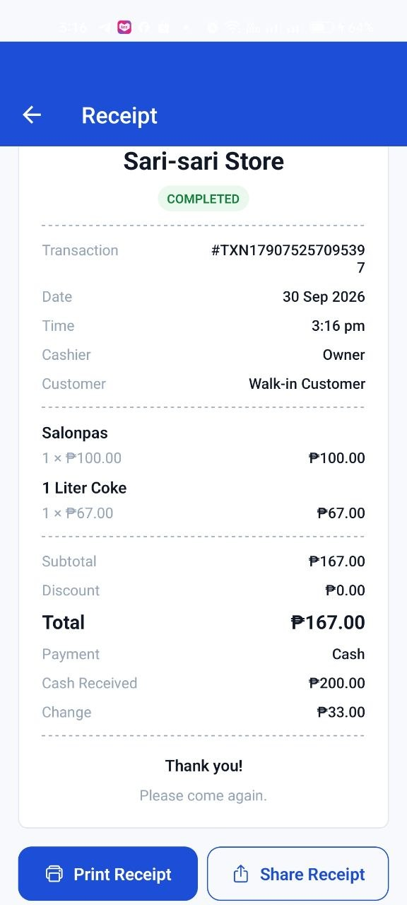
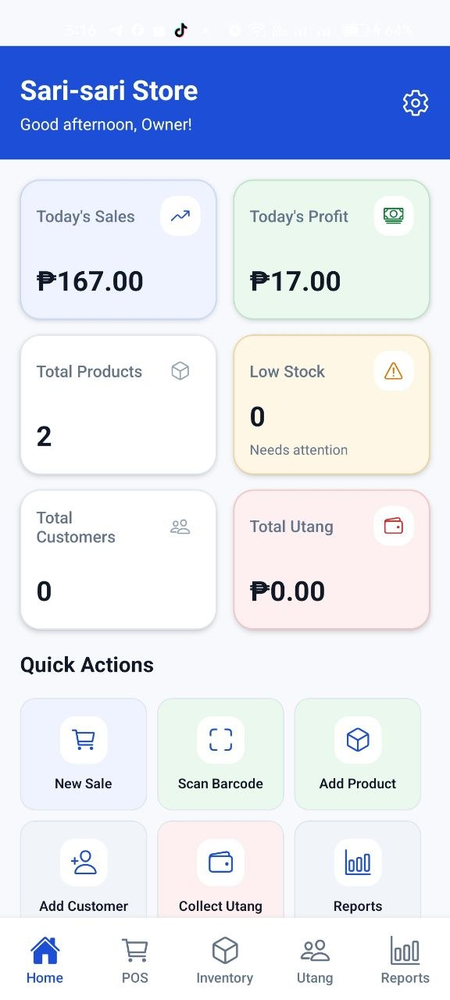
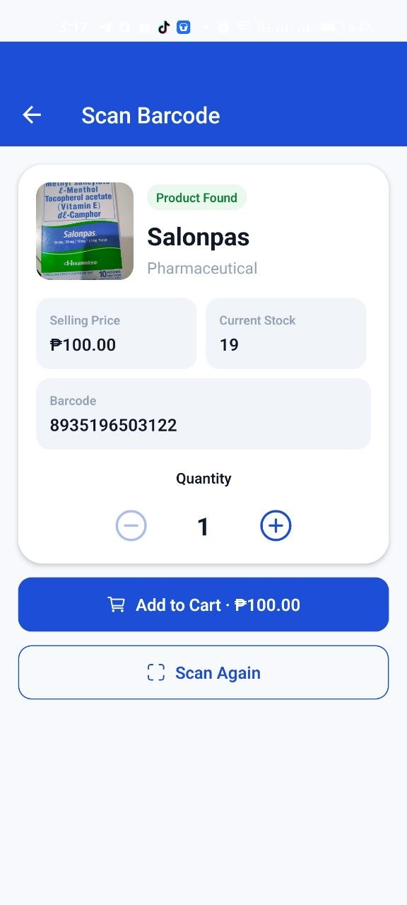
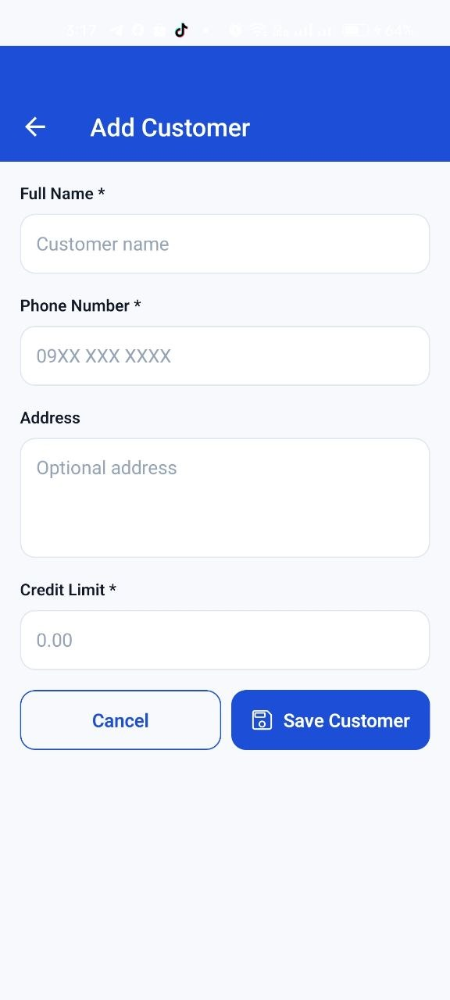
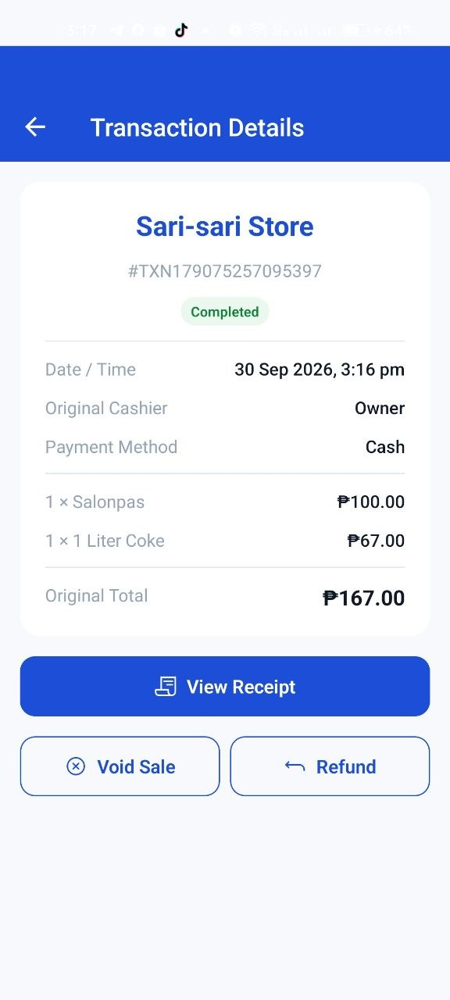
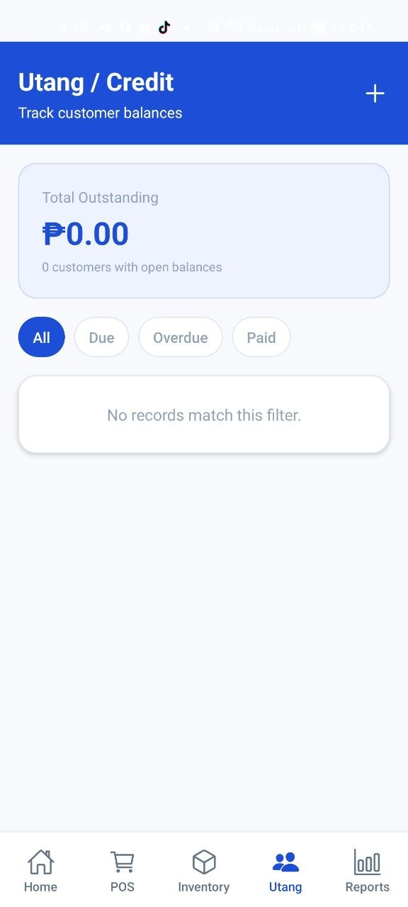
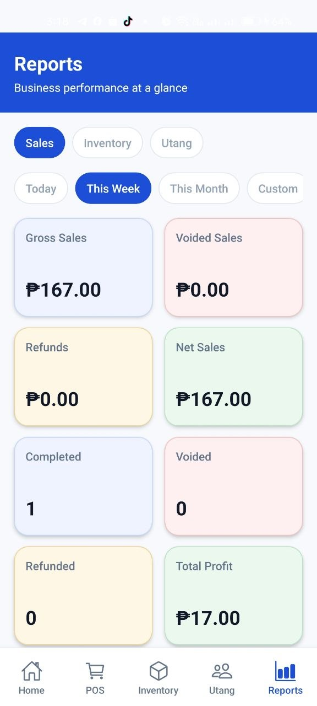
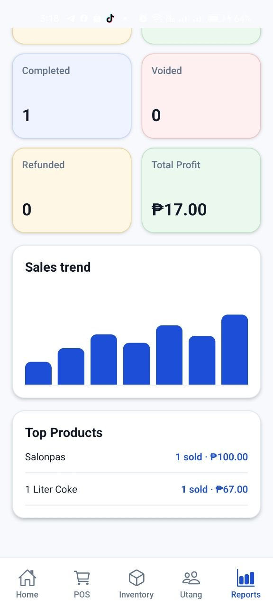


## Technology Stack

| Category | Technologies |
|---|---|
| Mobile app | React Native 0.81, React 19.1, Expo SDK 54, Expo Router 6, TypeScript 5.9 |
| Local database | SQLite (`expo-sqlite`) with versioned migrations |
| Cloud backend | Supabase (PostgreSQL, Auth, Row-Level Security, Deno Edge Function) |
| Native integration | Custom Expo module in Kotlin for Bluetooth ESC/POS printing |
| Device features | `expo-camera`, `expo-image-picker`, `expo-print`, `expo-secure-store`, `expo-network` |
| State management | React Context providers |
| Tooling | ESLint, EAS Build, Node/Python validation scripts |

## Architecture Highlights

- **Local-first data layer:** each table has its own repository module in `src/database/repositories`. Every write is saved to SQLite and added to `sync_queue` before any network call happens.
- **Sync engine:** pushes pending records in batches, then pulls only rows newer than the last sync point. Sales and stock movements are stored as insert-only records with stable IDs, so retries do not create duplicates. Editable records such as products and customers are merged by last-write-wins on `updated_at`.
- **Server-side admin:** owner enrollment and store reset run in a protected Supabase Edge Function, so the service-role key is never shipped in the app.

## Developer Information

- **Developer:** Rey C. Maghilom
- **Project Type:** Personal Full-Stack Development Project
- **Development Role:** Independent Software Developer

I independently developed this app for my mother's sari-sari store. My work covers the mobile UI, the SQLite schema and migrations, the offline sync engine, the Supabase schema, security policies and Edge Function, the Bluetooth printing module, and the validation scripts.

## Project Status

Version 1.0.0 includes the core workflows described above: POS, inventory, barcode scanning, utang, receipts, printing, sync, and backup. Known limitations: the date-range filter and sales trend chart on the Reports screen are UI placeholders and are not yet connected to data. Product images are stored only on the device and are not included in cloud backup. Payments through GCash and Maya are recorded manually; the app does not connect to a payment gateway.

## Getting Started

```powershell
npm install
Copy-Item .env.example .env   # add your Supabase project URL and publishable key
npm start                     # or: npm run android
```

Bluetooth printing needs a development build, since Expo Go does not include custom native modules. A fresh install starts with a temporary Owner PIN, which must be changed under Settings > Security before regular use. For setup details, see [docs/supabase-owner-auth.md](docs/supabase-owner-auth.md) (cloud backend) and [docs/bluetooth-printing.md](docs/bluetooth-printing.md) (printer builds).

Code checks: `npm run typecheck`, `npm run lint`, `npm run check:schema`, `npm run check:supabase-security`, `npm run check:backup`.
